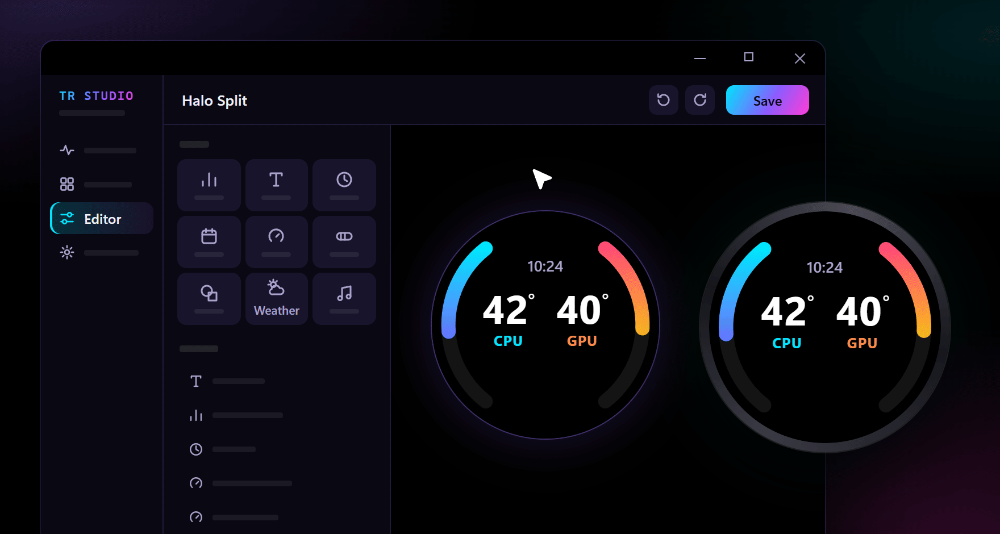
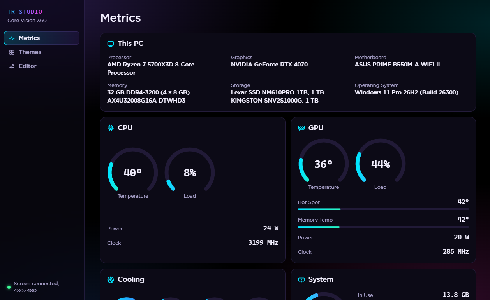
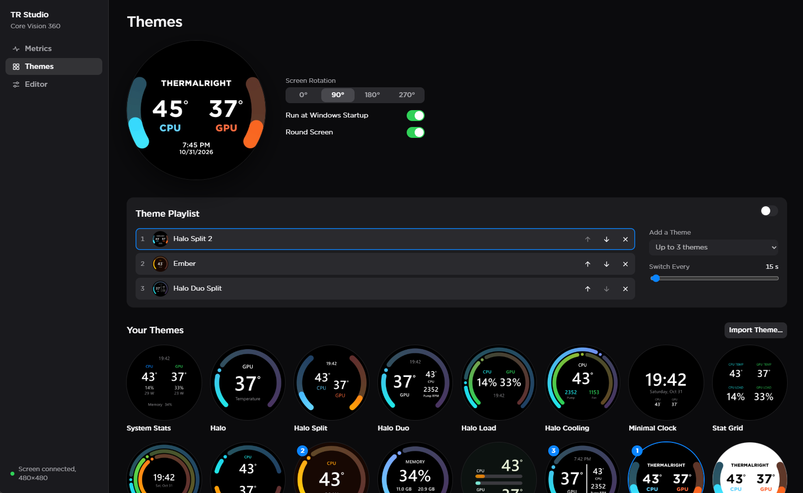
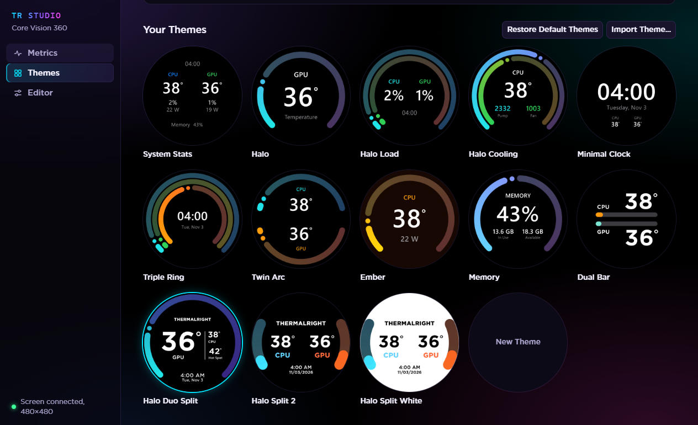
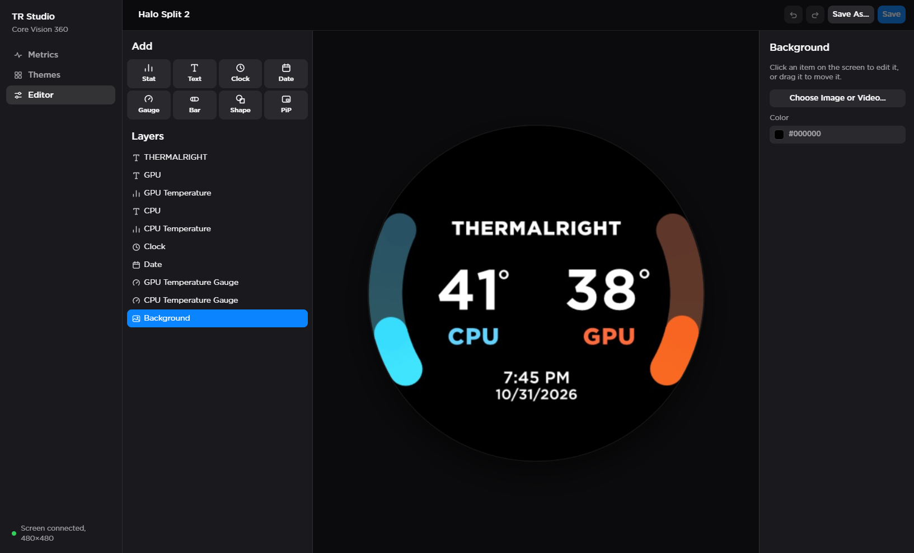
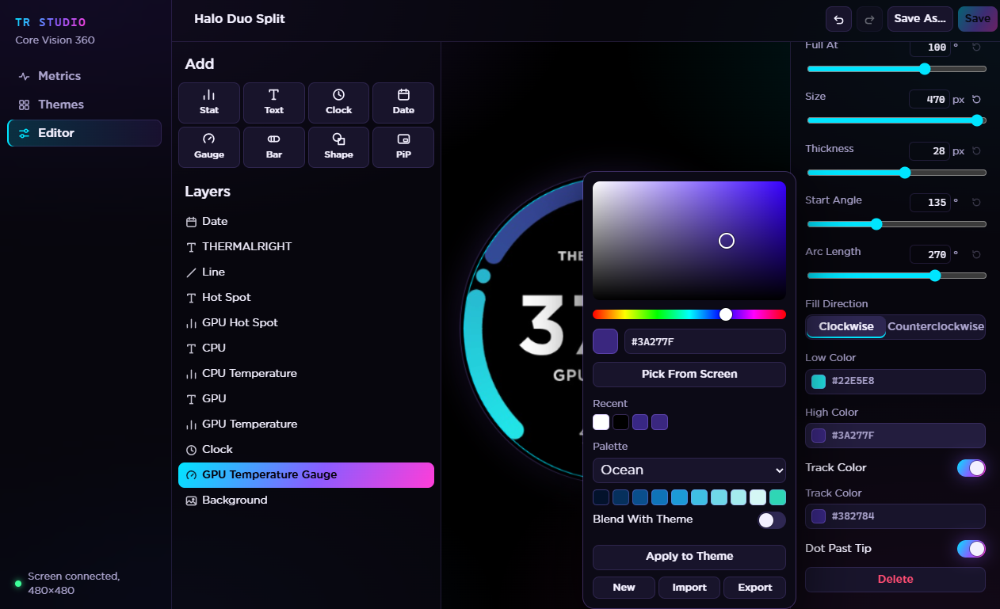

# TR Studio

[](https://github.com/iamfercatapang/tr-studio/releases/latest) [](https://github.com/iamfercatapang/tr-studio/releases)

TR Studio runs the screen on the Thermalright Core Vision 360 AIO cooler. It puts live system stats, themes, images and video on the cooler, and it replaces Thermalright's own TRCC software.

> TR Studio is an unofficial, independent project. Thermalright didn't make it and doesn't endorse or support it. Thermalright and Core Vision are their owner's trademarks.



## Why I built it

I like the Core Vision 360, but TRCC kept getting in the way. It crashed and froze, the interface was confusing, and it sometimes showed wrong or stale numbers, which is a problem for a screen whose whole job is showing stats.

So I wrote my own. I wanted something that stays running, that's easy to find your way around, and that only shows numbers you can trust. When TR Studio can't read a sensor, it shows a dash.

## Features

### Metrics

The Metrics page is a live dashboard with ring gauges and bars. It covers:

- CPU and GPU temperature, load, power and clock, plus the GPU's hot spot and memory temperature
- AIO pump, CPU fan, case fan and GPU fan speeds
- Memory load, how much is in use and available, memory speed, and motherboard temperature

A This PC tile lists your processor, graphics card, motherboard, memory, storage and Windows version. You can drag the tiles into whatever order you like.



### Themes

TR Studio comes with built-in themes, including Halo, Halo Duo Split, Twin Arc, Triple Ring, Stat Grid, Minimal Clock, Ember, Memory and Dual Bar. You can delete the ones you don't want and bring them back later. Themes export and import as `.tstheme` files with their images or video included, and the screen can be rotated in 90° steps.





### Theme Playlist

Pick 2 or 3 themes and the cooler cycles through them in the order you set, every 5 seconds to 10 minutes, with a crossfade between each one. The playlist pauses while you're in the Editor.

### Editor

Everything you change in the Editor shows up on the cooler as you go. You can add:

- Stats, text, clocks and dates
- Ring gauges and bars. Turn off Track Color and they show their full gradient with a marker at the reading instead
- Shapes and lines, in eight types, with rotation, gradients, opacity, outlines and dashed or dotted lines
- Picture-in-Picture, which mirrors a window, a whole screen or any part of your desktop onto the cooler live

Backgrounds can be an image, GIF, video or solid color. Layers can be reordered by dragging and hidden, and the Layers pane can be resized. Text gets a choice of fonts, a stroke and a shadow. Snapping guides help line things up, undo and redo cover every change, and you can type an exact value into any slider or reset it to its default. There's Save and Save As, and the Editor warns you when something runs off the edge of a round screen.



### Color

The color picker takes hex values, remembers recent colors, and has an eyedropper that works anywhere on your screen. It ships with 10 palettes of 10 colors each, and you can make your own and share them as `.tspalette` files.

With Blend With Theme on, picking a palette color on a gauge also recolors its bar, its stats and its label, and works out a matching gradient. Apply to Theme colors the whole theme from a palette in one click. Stats are kept readable against the background automatically. This only works with solid color backgrounds, since the app can't measure a picture or video.



### Warnings

TR Studio warns you if the AIO pump slows down or stops, or if the CPU or GPU gets too hot. You set each limit yourself on the Themes page, or turn a warning off. When a reading stays past its limit for a few seconds, the cooler screen shows the warning over your theme with a pulsing red ring, Windows shows a notification, and the app shows it in the sidebar. A sensor your PC doesn't report never sets one off.

### Smooth gauges

Gauges and bars move smoothly between readings, both on the cooler and in the app, so they don't jump once a second.

### Reliability

TR Studio sits in the system tray, and the cooler keeps working after you close the window. It pauses when the PC sleeps and picks up again on wake. If it loses the cooler, it keeps trying to reconnect. It can also start with Windows.

## Requirements

- Windows 10 version 1809 or later, or Windows 11, 64-bit
- Administrator rights, which the app needs to read CPU sensors
- [Microsoft Edge WebView2 Runtime](https://developer.microsoft.com/microsoft-edge/webview2/), which most PCs already have
- A Thermalright Core Vision 360, USB ID `87AD:70DB`

Only one app can drive the screen at a time, so close TRCC before you start TR Studio.

### Tested hardware

I've only tested TR Studio on my own PC, with a Core Vision 360 and its 480×480 screen. The same protocol reports other screen sizes and the app has code for them, but I haven't been able to try any. Support for the Trofeo Vision 9.16" (1920×462) is experimental: it was worked out from TRCC without the screen, and themes show in the middle of the wide screen for now. If you own one, I'd love to hear whether it works.

## Install

Download `TRStudio-<version>-Setup.exe` from the [latest release](https://github.com/iamfercatapang/tr-studio/releases/latest) and run it, or build it yourself as described below. It isn't code-signed, so Windows SmartScreen may warn you. Choose **More info**, then **Run anyway**.

If you uninstall, your themes and settings stay in `C:\ProgramData\CoreVisionStudio`.

## Build from source

You'll need the [.NET 8 SDK](https://dotnet.microsoft.com/download/dotnet/8.0).

```bash
dotnet build CoreVisionStudio.sln -c Release
```

```bash
dotnet test tests/CoreVision.Engine.Tests
```

Building the installer also takes [Inno Setup 6](https://jrsoftware.org/isinfo.php), plus `ffmpeg.exe` from an [LGPL build](https://github.com/BtbN/FFmpeg-Builds/releases) placed in `third-party/ffmpeg/`. FFmpeg isn't stored in this repository.

```bash
pwsh tools/BuildInstaller.ps1
```

The installer ends up in `artifacts/`.

## How it works

| Part | Purpose |
| --- | --- |
| `src/CoreVision.Engine` | USB protocol, sensors, theme rendering and storage |
| `src/CoreVision.App` | Tray app, plus the WebView2 interface in `wwwroot` |
| `tests/CoreVision.Engine.Tests` | Engine tests |
| `tools/` | Hardware probes, the browser interface preview and the build scripts |
| `installer/` | Inno Setup script |
| `docs/PROTOCOL.md` | Notes on the screen's USB protocol |

A few internal names, like `CoreVision.App.exe`, come from the project's working title.

[LibreHardwareMonitor](https://github.com/LibreHardwareMonitor/LibreHardwareMonitor) reads the sensors, and [FFmpeg](https://ffmpeg.org/) decodes video.

The interface uses the GothamSSm font when it's installed, and Segoe UI otherwise. The font isn't included.

## License

TR Studio is released under the [MIT License](LICENSE). The installer also includes FFmpeg, which keeps its own LGPL license, installed as `ffmpeg-LICENSE.txt`. LibreHardwareMonitor is used under the MPL 2.0.
